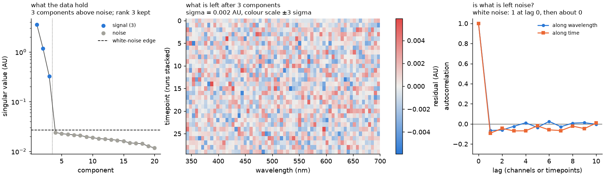
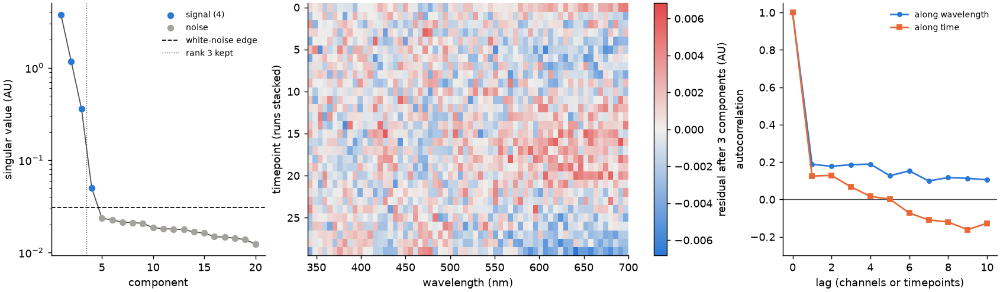

A UV/Vis time course is a mixture: at every time, the measured absorbance is the sum of
each species' concentration times its pure spectrum. Curve resolution splits the data
back into those two parts.

## Why you get a band, not a single answer

The data fix the **product** of concentrations and spectra, but usually not the split.
Mixing a little of one spectrum into another, and adjusting the concentrations to
match, reproduces the data exactly, and both spectra stay smooth and positive. No
amount of repeating the same measurement removes this; it is a property of the
experiment, not of the noise.

SpectraHandler therefore reports a **credible band**, built in two steps that keep
apart what the data determine and what they do not:

1. **What the data determine.** The product, and the noise level at every wavelength,
   get a Bayesian posterior (sampled with NumPyro). This is where the measurement
   noise enters.
2. **What they do not.** The split gets no prior at all. Every split that keeps
   concentrations and spectra non-negative is kept, where "non-negative" means: not
   below zero by more than the posterior of step 1 can explain.

The band is, for every concentration and every spectrum value, the range of its 95 %
posterior interval over all those splits. Its width is an honest statement of what
your data can and cannot tell you, provided that:

- the number of species you give is right,
- the noise is independent from spectrum to spectrum, with one level per wavelength,
  and independent between channels unless you give the fit a measured correlation
  (see [Noise that neighbouring channels share](#noise-that-neighbouring-channels-share)),
- the absorbance is concentrations times spectra, plus only the backgrounds you name
  (see [Baselines and backgrounds](#baselines-and-backgrounds)), and
- closure holds as given.

The splits are explored by a random walk (hit-and-run), so the band is an inner
approximation that can fall slightly short of the true extremes. On the synthetic
tests the band contained at least 95 % of the true amounts and spectrum values.

Methods that return a single split (classic MCR-ALS, NMF), or one Bayesian posterior
under a prior on the spectra, pick one point or one narrow region inside that band
without telling you that they did.

## What narrows the band

Only information the time course does not already contain:

- **Closure.** The species of one pool sum to a known total, e.g. 12.5 µM cobalamin.
  Taken from `initial_state`: every run sums to `initial_state[run].sum()`.
- **Reference spectra.** Every species you can measure pure pins its own spectrum.
- **Runs that change which species are present.** All runs share one set of pure
  spectra. A run in which a species is absent cuts the band markedly; a run that only
  changes the rates barely helps.

## A runnable example

```python
import jax
import jax.numpy as jnp

jax.config.update("jax_enable_x64", True)

from spectrahandler.curve_resolution import (
    SpectralDataset,
    make_realistic_dataset,
    resolve_band,
)

# Synthetic a -> b -> c data at 12.5 uM total, with known true spectra.
data, true_spectra, _ = make_realistic_dataset(jax.random.key(0))

# Suppose species "a" was measured pure: a 50 uM scan with 0.002 AU noise, divided
# by 50, gives its spectrum per uM with noise 0.002 / 50. Other species: NaN.
reference = jnp.full((3, data.n_wavelength), jnp.nan).at[0].set(true_spectra[0])
data = SpectralDataset.create(
    absorbance=data.absorbance,
    time=data.time,
    wavelength=data.wavelength,
    species=data.species,
    initial_state=data.initial_state,
    run_ids=data.run_ids,
    reference_spectra=reference,
    reference_sigma=jnp.array([0.002 / 50, jnp.nan, jnp.nan]),
)

band = resolve_band(data, jax.random.key(1))

print(f"{band.n_free} free re-mixing numbers, R-hat {band.r_hat:.3f}")
print(f"noise {float(band.sigma.min()):.4f} - {float(band.sigma.max()):.4f} AU")

# Only "a" has a reference, so only its name is pinned: the columns for "b" and "c"
# may come back swapped (see below).
lo, hi = band.concentration_lower[0, 10, 0], band.concentration_upper[0, 10, 0]
print(f"a at t = {float(data.time[0, 10]):.1f} h: {float(lo):.2f} - {float(hi):.2f} uM")
```

On this data species `a` at 3.4 h comes out between about 0.05 and 2.16 µM; the true
value is 1.58 µM. The noise comes out between 0.0015 and 0.0028 AU per wavelength (the
true value is 0.002 everywhere; each wavelength has only 30 spectra to estimate it
from). The whole call takes about 8 s on a laptop.

## Reading the result

| Field | What it is |
| --- | --- |
| `concentration_lower`, `concentration_upper` | The band for every amount, in your concentration unit |
| `spectra_lower`, `spectra_upper` | The band for every spectrum value, in absorbance per concentration unit. The run axis has size 1: all runs share one set of spectra |
| `concentration_ambiguity`, `spectra_ambiguity` | The same extremes for the posterior mean alone: the rotational ambiguity without the noise part, still including the small tolerance below zero |
| `concentration_draws`, `spectra_draws` | Draws spread evenly over all splits that fit, with noise. A *typical-solution* summary under a stated flat prior, not a calibrated interval |
| `sigma`, `sigma_draws` | The noise standard deviation at every wavelength: posterior mean and posterior draws, in absorbance units |
| `level` | The credibility level of the band, 0.95 by default |
| `n_free` | How many numbers the data leave undetermined |
| `r_hat` | Agreement between the sampling chains of step 1; close to 1 is good, and above 1.05 you get a warning |
| `background_names`, `background_amplitude` | The backgrounds that were removed and their amounts per run, in absorbance units |
| `background_draws` | Posterior draws of each run's amounts relative to the first run |
| `baseline_tolerance`, `zero_source` | By how much zero absorbance may be off at each wavelength, and where zero came from |

Species **without** a reference are resolved only up to relabelling among themselves:
the band for "b" may be the spectrum you know as "c". Give a reference, or a run where
one of them is absent, to pin the names.

To see the band of one run, `plot_deconvolution(band, data, data.run_ids[0])` from
`spectrahandler.plot` shades it for every species; see
[Plotting results](/SpectraHandler/guides/plotting/).

## Is the number of species right?

Every split in the band reproduces the data through the same best fit, so the fit
cannot tell splits apart. It can tell you whether the number of species is right:
after removing that many components, what is left should be plain noise.

```python
from spectrahandler.curve_resolution import noise_diagnostics
from spectrahandler.plot import plot_noise

diagnostics = noise_diagnostics(data)
print(f"{diagnostics.n_above_noise} components above the noise edge")
plot_noise(diagnostics, data).savefig("noise.png")
```

On the example data this prints `3 components above the noise edge`, and the figure
looks like this:



- **Left, what the data hold.** Singular values above the dashed white-noise edge
  carry signal. Their count should equal your number of species.
- **Middle, what is left.** The residual after that many components, over time and
  wavelength. Even static is noise; stripes, steps or blobs are something the model
  is missing.
- **Right, is it noise?** The residual's autocorrelation. White noise is 1 at lag 0
  and about 0 after.

The same data with a slowly drifting offset added, which is one more component:



What to do with what you see:

- **More components above the edge than species:** an unmodelled species, a baseline,
  or a per-run offset. Each is one more component; the band assumes there are none.
- **Autocorrelation near 1 along wavelength:** the export was smoothed or interpolated
  along wavelength, as JASCO interval scans are. Neighbouring points then share their
  noise. Measure that with `measure_noise_correlation` and pass it as
  `noise_correlation`; see
  [Noise that neighbouring channels share](#noise-that-neighbouring-channels-share).

## Noise that neighbouring channels share

The band counts every wavelength channel as one independent measurement. Many
detectors do not deliver that: the readout or the software averages or interpolates
along wavelength, so neighbouring channels carry partly the same noise. Counting them
as independent claims more information than the data hold, and the band comes out too
narrow, or the fit fails with "no feasible split".

Binning the channels is the usual fix, but it guesses the width and throws detail away.
Instead, **measure the correlation and give it to the fit**. Any static sample will do:
a blank, or the end of a run where the spectra no longer change.

```python
import dataclasses

from spectrahandler.curve_resolution import make_correlated_noise, measure_noise_correlation

# 128 channels whose noise is averaged over 8 neighbours, as a detector might do.
clean, _, _ = make_realistic_dataset(jax.random.key(0), noise=0.0, n_wavelength=128)
noise = 0.002 * make_correlated_noise(jax.random.key(3), clean.n_time, 128, width=8)
noisy = dataclasses.replace(clean, absorbance=clean.absorbance + noise[None])

# A blank on the same instrument: 100 spectra of nothing but noise.
blank = 0.002 * make_correlated_noise(jax.random.key(99), 100, 128, width=8)
correlation = measure_noise_correlation(blank)

print(correlation.correlation(10).round(2))  # by distance in channels
print(f"shared by the whole spectrum: {correlation.shared:.2f}")

band = resolve_band(noisy, jax.random.key(1), noise_correlation=correlation)
```

The printed correlation falls from 1 at distance 0 to 0.83 at one channel and to about
zero at eight: the average over eight channels, read off the data without being told.
`shared` is the part of the noise that every channel of a spectrum has in common, such
as a flicker of the lamp.

- **Measure on the same channel spacing** as the data you resolve, and unbinned data
  can then go in as they are.
- **The sample must be static.** The noise is taken from the differences between
  consecutive spectra; a reaction in progress would be mistaken for noise.
- **More blank spectra, better measurement:** about 100 give every part of the
  correlation to 10 %.
- **The noise level is still inferred**, one per wavelength, with its posterior. Only
  the correlation between channels comes from the blank.

### Noise that grows with the signal

Where a sample absorbs, less light reaches the detector and the absorbance is noisier.
For a detector limited by photon counting the noise grows as `10 ** (0.5 * A)`.
`noise_exponent` sets that exponent: `0.0` (the default) is noise that does not depend
on the signal, `0.5` is photon counting, and `None` infers it from the data:

```python
band = resolve_band(noisy, jax.random.key(1), noise_exponent=None)
print(f"{float(band.noise_exponent_draws.mean()):.2f}")
```

The data can only tell if the absorbance varies enough: with spectra reaching 1.3 AU
the exponent comes out to ±0.06, with spectra below 0.35 AU, as here, only to about
±0.2, and the prior (0.5 ± 0.5) does much of the work. `sigma` is then the noise at
each wavelength's average absorbance.

## Baselines and backgrounds

Real spectra are rarely concentrations times spectra and nothing else. A cuvette sits a
little differently in every run, a lamp drifts, and the whole spectrum is shifted or
tilted by a few thousandths of an absorbance unit.

The baseline has two parts, and they are found in different ways.

**How the runs differ from each other** is inferred by the fit itself, with no input
from you. All runs share one set of species spectra, so if one run sits a little higher
or is tilted against another, at every time, that cannot be chemistry. By default every
run after the first gets an offset and a tilt relative to the first run, each with a
posterior (`background_draws`).

**What all runs have in common** cannot be found that way: a line added to every run
can be moved into the species spectra without changing the fit. It needs outside
information, a wavelength range where **no species absorbs**, a zero window. There the
data hold only background and noise, so the common amount of each background is measured
there, and its known shape carries it across the rest of the spectrum. Without a zero
window the first run's zero is taken as it is.

```python
import dataclasses

from spectrahandler.curve_resolution import Background

# The same data, with everything 0.005 AU too high.
shifted = dataclasses.replace(data, absorbance=data.absorbance + 0.005)

band = resolve_band(
    shifted,
    jax.random.key(1),
    backgrounds=(Background.offset(),),
    zero_windows=((660.0, 700.0),),  # nm; no species of this example absorbs here
)

print(band.zero_source)
print(f"offset {float(band.background_amplitude[0, 0]):.4f} AU")
print(f"tolerance {float(band.baseline_tolerance[-1]):.4f} AU in the window")
print(f"tolerance {float(band.baseline_tolerance[0]):.4f} AU outside")
```

This recovers the offset as 0.0050 AU. The **baseline tolerance** is what the backgrounds
could not explain inside the window: here 0.0011 AU, which is just noise. Outside the
window it is 0.0021 AU. The band uses it in two ways: a spectrum may dip below zero by
the tolerance (per unit concentration), and the spectrum band is widened by the same
amount.

- **Backgrounds provided:** `Background.offset()` (flat) and `Background.tilt()` (a
  straight line); both are used unless you say otherwise. Any other known shape is
  `Background(name, shape)`, with `shape` a function of the wavelength grid.
  `backgrounds=()` switches baselines off altogether.
- **The window is an assumption, and the tolerance tests it.** A species that absorbs
  weakly inside the window raises the tolerance by about its absorbance. A tolerance
  comparable to your signal means the window is not empty.
- **A common tilt needs a wide window.** A line fitted over 40 nm and extended over
  300 nm multiplies every small error. The tolerance outside the window grows
  accordingly (one plus the leverage of the fit, a worst case) and the band with it.
  Use an offset alone when the window is narrow. The tilt of one run against another
  does not have this problem: it comes from the whole spectrum.
- **A blank gives a tighter tolerance.** A buffer blank has no absorber anywhere. Put it
  through `fit_backgrounds` with the same backgrounds and window; what it leaves outside
  the window is the real baseline error there. Pass that as `baseline_tolerance`, one
  value per wavelength, and it replaces the worst case.
- **Reference spectra and the zero.** With a zero window every reference gets background
  amounts of its own, so a blank can be used as a reference as it was measured. Without
  a zero window the references are taken to share the data's zero, and must be
  baseline-free.
- **The baseline is constant within a run.** A baseline that moves during a run is not
  modelled; inside a zero window it shows up as a larger tolerance.
- **A mismatch the model has no place for hides in the noise.** A missing species, or
  baselines switched off, makes the model explain the misfit as noise and still return
  a band. An inferred `sigma` well above what your instrument delivers is the sign.

## Tuning

`resolve_band` exposes its knobs with defaults that worked on synthetic data:

- `level`: the credibility level of the band. Default 0.95.
- `sigma`: the noise level, one number or one per wavelength. By default one per
  wavelength is inferred from the data; pass a value measured on a blank if you have
  one.
- `noise_scale`: the scale of the prior on the inferred noise levels. The default is
  the RMS absorbance, which leaves the data to decide.
- `noise_correlation`, `noise_exponent`: see
  [Noise that neighbouring channels share](#noise-that-neighbouring-channels-share).
- `backgrounds`, `zero_windows`, `baseline_tolerance`, `baseline_smoothing`: see
  [Baselines and backgrounds](#baselines-and-backgrounds).
- `num_warmup`, `num_samples`, `num_chains`, `target_accept_prob`: the NUTS sampler of
  step 1. Raise the first two if you get the R-hat warning.
- `n_iter`, `n_burn`, `thin`: length of the walk over the feasible region.
- `n_als`, `n_restart`, `n_search`: the search for a first split that fits.

Current limits: every run must be fully measured, the number of species is given, and
a background has one amount per run, constant in time.

## Reading JASCO exports

`spectrahandler.jasco` reads JASCO CSV exports into plain arrays. An interval-scan
export holds a whole run in one file; a run recorded as one file per timepoint, named
like `run1_15min.csv` or `run1_2h.csv`, is read with `read_spectrum_series`, which
orders the files by the time in their names. Either way you get a `Scan` with
`wavelength_nm`, `time_min` (always in minutes) and `absorbance` shaped
`(n_time, n_wavelength)`. `SpectralDataset.create` wants a leading run axis and times
in the dataset's time unit, hours by default:

```python
import jax
import jax.numpy as jnp

jax.config.update("jax_enable_x64", True)

from spectrahandler.curve_resolution import SpectralDataset
from spectrahandler.jasco import read_interval_scan, read_spectrum_series

scan = read_interval_scan("my_scan.csv")
# one file per timepoint: scan = read_spectrum_series(["run1_0min.csv", "run1_15min.csv"])

data = SpectralDataset.create(
    absorbance=jnp.asarray(scan.absorbance)[None],  # (1 run, n_time, n_wavelength)
    time=jnp.asarray(scan.time_min)[None] / 60.0,  # minutes -> hours
    wavelength=jnp.asarray(scan.wavelength_nm),
    species=("a", "b", "c"),
    initial_state=jnp.array([[12.5, 0.0, 0.0]]),  # uM at the start, one row per run
    run_ids=("run 1",),
    time_unit="h",
)
```

Several runs stack along the first axis with `jnp.stack`, and need the same wavelength
grid and the same number of timepoints. JASCO interval scans are interpolated along
wavelength, which fools the automatic noise estimate; see
[Is the number of species right?](#is-the-number-of-species-right) above.
